<p align="center">
  
</p>

<p align="center">
  
  
  
  
</p>

<p align="center">
  Una caja negra que vive arriba al centro de tu Mac, pegada al notch.<br>
  Guarda archivos, abre tus carpetas, controla tu música y toma notas, sin salir de lo que estás haciendo.
</p>

---

## Cómo se usa

### 1. Actívala y desactívala con el switch

<p align="center">
  
</p>

Expandida mide **7 × 5 cm reales**. Con el switch se contrae a una línea de **7 × 1 cm** que deja a la mano play y siguiente. También puedes usar el atajo `Ctrl + Opción + Espacio`.

### 2. Arrastra cualquier cosa adentro

<p align="center">
  
</p>

Archivos, carpetas, PDFs, imágenes y capturas de pantalla se quedan guardados ahí hasta que los uses. Doble clic los abre, y los puedes arrastrar de vuelta a donde quieras. Si sueltas un archivo sobre la línea contraída, la caja se abre sola.

### 3. Cinco pestañas

<p align="center">
  
</p>

| Pestaña | Para qué sirve |
|---|---|
| **Archivos** | Tu estante temporal. Las capturas flotantes se copian a una carpeta propia para que macOS no las borre. |
| **Carpetas** | Las carpetas de tu Escritorio (o la que elijas) a un clic. Se actualiza sola, y arrastrar una carpeta hacia afuera la **copia**, no la mueve. |
| **Música** | Portada, canción, progreso, anterior, play/pausa, siguiente y volumen de Spotify. |
| **Portapapeles** | Lo último que copiaste. No guarda nada en disco e ignora lo que copian los gestores de contraseñas. |
| **Notas** | Un bloc rápido que se guarda solo. |

Clic derecho sobre la caja para: **Auto-contraer** al sacar el mouse, **Abrir al iniciar sesión**, **Vaciar estante** y **Salir**.

---

## Instalar

**Requisitos:** macOS 13 o superior, Xcode (gratis en la App Store) y Spotify de escritorio para la pestaña de música.

```bash
git clone https://github.com/emilianocros27-bit/blacktrack.git
cd blacktrack
bash build.sh
```

Para dejarla instalada:

```bash
cp -R build/blacktrack.app /Applications/
open /Applications/blacktrack.app
```

Luego haz clic derecho sobre la caja y activa **Abrir al iniciar sesión**.

### O deja que Claude lo haga

Si tu Claude puede usar la terminal de tu Mac, pégale esto:

> Clona https://github.com/emilianocros27-bit/blacktrack, lee README.md y CLAUDE.md, y déjame blacktrack instalada y funcionando en mi Mac. Avísame antes de hacer algo que cambie mi sistema. Háblame en español, paso a paso, y dime qué debo ver en pantalla en cada etapa.

---

## Permisos

| macOS te pregunta por | Qué hacer |
|---|---|
| Controlar **Spotify** | Pulsa **Permitir**. Si no salió, ve a Ajustes del Sistema → Privacidad y seguridad → Automatización. |
| Acceder al **Escritorio** | Pulsa **Permitir**, para que la pestaña Carpetas pueda leerlo. |
| Licencia de **Xcode** | Ejecuta `sudo xcodebuild -license accept` una vez. |

## Personalizar

| Quiero cambiar | Dónde |
|---|---|
| La carpeta de la pestaña Carpetas | `Sources/LemiShelf/Config.swift` → `foldersPath` |
| El tamaño de la caja | `Sources/LemiShelf/PanelController.swift` → `updateMetrics()` |
| La curva del volumen | `Sources/LemiShelf/MusicView.swift` → `curve` |

Después de cualquier cambio, vuelve a correr `bash build.sh`.

## Si algo falla

- `permission denied: ./build.sh` → usa `bash build.sh`.
- La música dice que Spotify no está abierto → revisa el permiso de Automatización.
- Sale una línea con `error:` al compilar → ese es el problema; pégasela a tu Claude junto con el archivo al que apunta.

---

<p align="center"><sub>Hecho con SwiftUI + AppKit · Las animaciones de esta página son SVG, sin videos.</sub></p>
